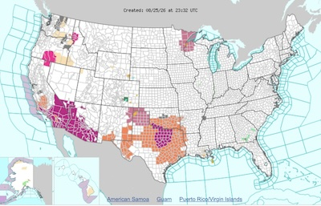
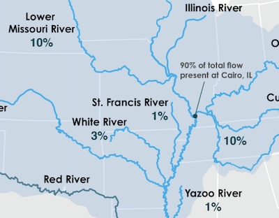
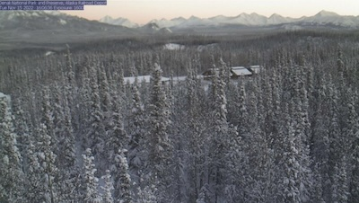
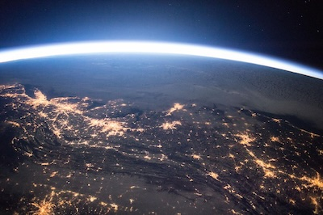

# Awesome Government Data

List of useful and/or interesting datasets, API's and tools relating to government data.

Initial collection is built on a US and California list but repo is not limited to these geographies.

| Thumbnails | | | |
| --- | --- | --- | --- |
|  [Weather.gov](https://www.weather.gov) |  [drought.gov](https://www.drought.gov) |  [Alaska Railroad Depot](https://www.nps.gov/media/webcam/view.htm?id=81B466C8-1DD8-B71B-0B09BF265A80000E) |   [images.nasa.gov](https://images.nasa.gov/)|

---

* [Weather.gov](https://www.weather.gov) : National Weather Service
  * and the weather.gov [API](https://api.weather.gov)
* [ USPS state abbreviations](https://about.usps.com/who/profile/history/state-abbreviations.htm)
  * includes current, 1963, 1943, 1874 and 1831 abbreviations
* [Drought.gov](https://www.drought.gov/data-maps-tools?page=4) : National Integrated Drought Information Services
  * such as [Mississippi River Flow Contribution Diagram](https://www.drought.gov/documents/mississippi-river-flow-contribution-diagram)
* EPA [Daily Data Download](https://www.epa.gov/outdoor-air-quality-data/download-daily-data) : "queries daily air quality summary statistics for the criteria pollutants by monitor."
  * [AirNow](https://www.airnow.gov/?)
* USPTO [Patent Public Search Basic ](https://ppubs.uspto.gov/basic/) (PPUBS Basic)
* [OSHA Data](https://www.osha.gov/data) : Data Available to View and Download
* Supreme Court of the United States : [Oral Argument Transcripts](https://www.supremecourt.gov/oral_arguments/argument_transcript/2025)
* National Park Service [webcams](https://www.nps.gov/media/multimedia-search.htm#fq%5B%5D=Type%3A%22Webcam%22) at NPS.gov
  * such as the [Alaska Railroad Depot](https://www.nps.gov/media/webcam/view.htm?id=81B466C8-1DD8-B71B-0B09BF265A80000E)
* [images.nasa.gov](https://images.nasa.gov/) : NASA Image and Video Library
  * and the [images.nasa.gov API Documentation](https://images.nasa.gov/docs/images.nasa.gov_api_docs.pdf)
  * can find images like this [view of a blizzard from space](https://images.nasa.gov/details/iss046e022766)
* [USGS APIS](https://www.usgs.gov/products/web-tools/apis) : U.S. Geological Survey APIs and Web Tools
  * includes the [Real-Time Flood Impact Map](https://www.usgs.gov/tools/real-time-flood-impact-map)

---

* [California Open Data](https://data.ca.gov)
  * such as [American Crow Range](https://data.ca.gov/dataset/american-crow-range-cwhr-b353-ds1582) - CWHR B353 [ds1582]
* San Jose Valley Water [Watershed Webcams](https://valleywateralert.org/scvwd/webcams/watersheds.php#cam)

---

If you have a suggestion either create an issue or fork, edit & submit a pull request.

Include a URL, some descriptive text and an interesting specific link (or note) about the submission.

